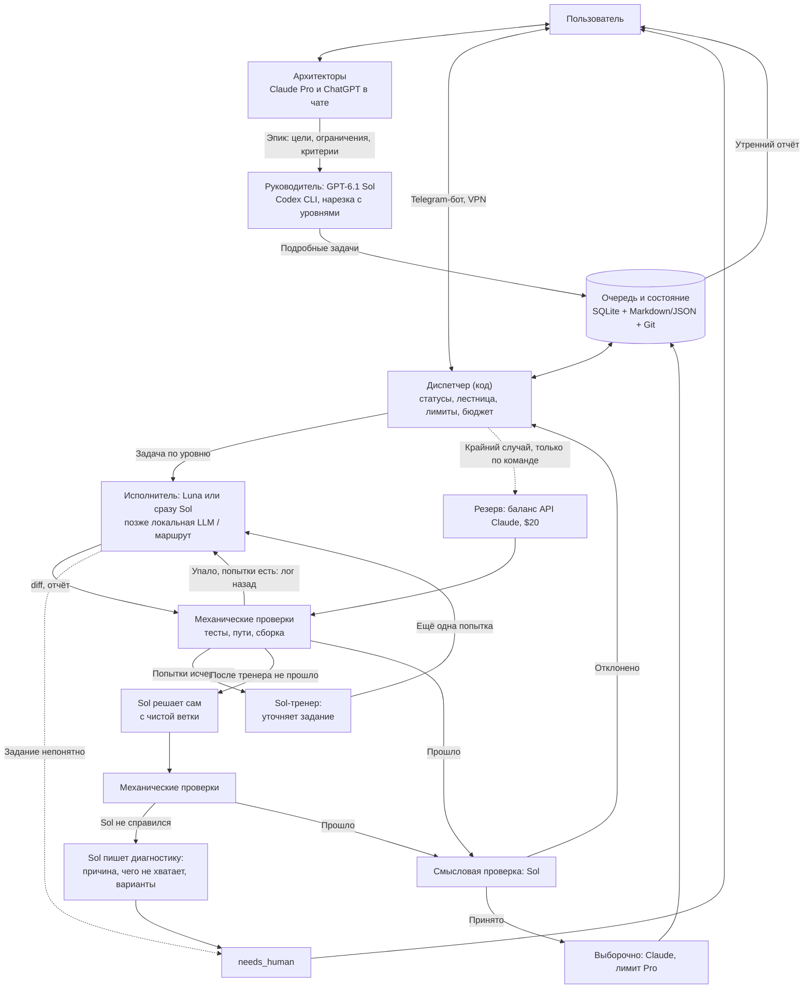

# Локальный ИИ-конвейер разработки: архитектура и план пилота

> **Статус:** проектное ТЗ / рабочая концепция, версия 0.5  
> **Дата:** 23 октября 2026  
> **Цель:** построить экономный и отказоустойчивый конвейер разработки, который работает ночью и в те дни, когда пользователь на работе. **Основная конфигурация (A):** двигатель конвейера — Codex на подписке ChatGPT Plus: GPT-6 Luna исполняет, GPT-6.1 Sol на максимальном усилии руководит. Claude на лимите Pro — архитектор в чате и выборочный проверяющий в конвейере. Деньги на балансе API Claude — только крайний случай. **Резервная конфигурация (B):** только Claude Max, включается по заранее заданным условиям (раздел 17). Человек сохраняет контроль над архитектурой, приоритетами, реальным оборудованием и финальным принятием.

## 0. Что изменилось

### В версии 0.5

- **Основа диспетчера — oh-my-symphony** (open source, Apache 2.0, Python), а не собственная разработка с нуля. Наш документ остаётся спецификацией: что взято готовым, а что дописывается — в разделе 15.
- **Управление — готовыми средствами** (веб-панель через VPN, уведомления), Telegram-бот — по желанию позже (раздел 11).
- **Требование независимости:** оркестратор не должен зависеть от чужого сервиса, который может заблокировать доступ.

### В версии 0.4

- **Старт — конфигурация A** (Claude Pro + ChatGPT Plus по $20, плюс $20 на балансе API Claude). **Переход на B — только Claude Max за $100** — при одном из двух условий: 5-часового окна Codex не хватает даже с локальной LLM, или прекратились регулярные обнуления лимитов (раздел 17).
- **Уровни задач** (раздел 5.1): при нарезке каждой задаче назначается модель и усилие — **с запасом**. Провал дешёвой ступени обходится дороже её собственной попытки: дальше подключается Sol из узкого окна, и задача теряет ночь.
- **Узкое место — 5-часовое окно Codex**: недельный лимит обнуляется, окно — нет. Добавлены: «тренер» перед самостоятельной работой Sol (4.1), усилие по операциям (4.5), планировщик окон (7.4), ночной перелив смысловых проверок на Claude Pro как опция (7.5).
- **Локальная LLM**: три режима для сравнения, уровень задачи может быть коротким маршрутом, например «подготовка локалкой → Luna» (4.6).
- **Переезд EVE на MCP — в фоне сразу**, чтобы переход на B не зависел от него.

### В версии 0.3

- **Основная конфигурация — A, Codex-ступени на ChatGPT Plus.** Причина: около месяца лимиты Codex на Plus (и 5-часовые, и недельные) обнуляются примерно через сутки после приближения к нулю. Это не гарантировано: OpenAI называет такие сбросы эпизодическими и не обещает будущих. Поэтому конфигурация A действует, **пока метод работает**, а условия перехода на B заданы заранее (раздел 17).
- **Подписки: Claude Pro + ChatGPT Plus ($40) + $20 на балансе API Claude как резерв на крайний случай = $60 в месяц.**
- **Лимит Claude Pro работает на проекты:** архитектура и ревью в чате плюс выборочная проверка в конвейере, с резервом для пользователя. Когда исполнение ушло в Codex, лимита Pro должно хватать надолго.
- **Баланс API Claude автоматически не тратится.** Это универсальный резерв на любую экстренную ситуацию: рабочая задача, когда Pro исчерпан, или срочная задача конвейера, когда недоступны и Codex, и Pro. Расход — только по решению пользователя.
- **Руководитель — GPT-6.1 Sol на max.** Ошибка руководителя поднимается до уровня Claude и тратит лимит Pro, поэтому на руководителе не экономим.
- **ChatGPT Plus остаётся.** Интеграция EVE на ChatGPT продолжает работать; переезд на MCP к Claude не срочный, но желателен для независимости.
- **Claude Max (конфигурация B из версии 0.2) — резерв**, все её решения сохранены в разделе 17.

### В версии 0.2 (кратко)

Gemini исключён (доступ закрыт на уровне аккаунта); вместо отдельного облачного куратора — лестница моделей; источники ресурса («кошельки»); классы задач, включая рабочие проекты; дневной режим и удалённое управление.

## 1. Ключевая идея

Оркестратор остаётся **локальным и независимым от конкретной модели**. Завершение подписки, исчерпание лимита, прекращение обнулений или отсутствие сети не должны терять состояние и не должны останавливать проект навсегда. Конфигурации A и B переключаются настройкой диспетчера, а не переделкой.

- **Архитекторы — пользователь, Claude в чате (Pro) и ChatGPT в чате.** Цели, архитектура, постановка эпиков, разбор `needs_human`, утреннее ревью. ChatGPT — второй сильный ревизор для спорных решений; в обычном чате он не расходует пул Codex.
- **Диспетчер — программный код, не LLM.** Очередь, статусы, запуск, механические проверки, лестница, учёт лимитов и обнулений, бюджет, восстановление, отчёты.
- **Руководитель — GPT-6.1 Sol через Codex, усилие по операциям (раздел 4.5).** Нарезает эпик на подробные задачи и назначает им уровни, проверяет результаты по смыслу, работает тренером для исполнителя, разбирает провалы, сам решает задачи, на которых споткнулся исполнитель.
- **Исполнитель — GPT-6 Luna через Codex.** Подробно нарезанные задачи большого объёма.
- **Выборочный проверяющий — Claude Sonnet на лимите Pro** (вход в аккаунт, не API-ключ). Перепроверяет часть принятых задач моделью другого семейства: читает дифф и задание, сам ничего не переделывает. Это прибор для измерения, можно ли доверять приёмке Sol, а не полная проверка. Работает в пределах резерва пользователя.
- **Резерв на крайний случай — $20 на балансе API Claude.** Тратится только по ручному решению: рабочие задачи через Playground, когда Pro исчерпан, или срочная задача конвейера командой `/urgent`.
- **Локальная LLM на Mac mini M6 (32 ГБ)** — будущая нижняя ступень.
- **Пользователь** — приоритеты, проверка на стенде, допуск опасных действий, финальное принятие.

Главное правило распределения ресурса в конфигурации A: **ChatGPT Plus — двигатель конвейера; лимит Claude Pro — проекты (архитектура, ревью и выборочная проверка в конвейере) с резервом для пользователя; баланс API Claude — только крайний случай, по ручному решению.**

Главная метрика — **стоимость одной принятой задачи**: в конфигурации A это прежде всего расход лимитов Codex и число задач, дошедших до людей.

## 2. Схема (конфигурация A)



Разделены четыре функции: постановка работы (архитекторы), нарезка и контроль (руководитель), детерминированное управление (диспетчер) и генерация кода (исполнитель).

## 3. Роли и границы ответственности

| Компонент | Что делает | Чего не делает |
|---|---|---|
| Пользователь | Приоритеты, архитектурные решения, проверка на стенде, допуск рискованных действий, финальное принятие | Не следит за каждой попыткой ночью |
| Claude в чате (Pro) | Архитектура, постановка эпиков, разбор `needs_human` пачкой, утреннее ревью, живые рабочие задачи | Не исполняет и не нарезает рутину |
| ChatGPT в чате | Второй архитектор и сильный ревизор спорных решений | Не используется как неофициальный машинный API |
| Диспетчер | Очередь, статусы, механические проверки, лестница, учёт лимитов Codex и обнулений, бюджет API, восстановление, отчёты | Не принимает творческих решений, не полагается на LLM для контроля процессов |
| Руководитель (Sol) | Нарезка эпиков с назначением уровней, смысловая проверка, шаг тренера, разбор провалов, решение задач, на которых споткнулся исполнитель | Не меняет архитектуру и цели эпика; не трогает реальное оборудование |
| Исполнитель (Luna) | Исполнение подробно нарезанных задач | Не меняет существующие тесты, публичные интерфейсы и зависимости без разрешения в задаче |
| Claude в конвейере (Sonnet, лимит Pro) | Выборочная перепроверка принятых задач по диффу и заданию | Не переделывает задачи; не решает задачи после Sol (только по ручному включению); не выходит за порог резерва |
| Баланс API Claude | Крайний случай: рабочие задачи через Playground, срочные задачи конвейера по команде | Не тратится автоматически |
| Локальная LLM (будущая) | Простые задачи: тесты, документация, мелкие правки | Не берёт классы задач с частыми эскалациями |

## 4. Лестница моделей

### 4.1. Порядок (конфигурация A)

1. **Стартовая ступень — по уровню задачи** (раздел 5.1). Для L1 и L2 это Luna (после приезда Mac — локальная LLM или маршрут из раздела 4.6), для S1 и S2 — сразу Sol. До **2 попыток**. Если механическая проверка не прошла, диспетчер сам возвращает задачу с логом ошибок; руководитель в этом цикле не участвует.
2. **Ступень 2 — Sol.** Сначала **как тренер**: коротко разбирает, почему исполнитель споткнулся, и переписывает задание точнее. Исполнитель делает ещё одну попытку по новой инструкции. Это один короткий вызов Sol вместо долгой многошаговой работы. Если и эта попытка не прошла — Sol решает задачу сам, **с чистой ветки** от той же базы, со сводкой всех попыток. До **1–2 попыток**. Для задач, стартовавших сразу на Sol, шаг тренера пропускается.
3. **Ступень 3 — `needs_human` с диагностикой.** Если Sol не справился, он пишет короткий структурированный отчёт: что пробовали, почему не вышло, к какому типу относится причина (неясное или противоречивое задание, не хватает данных или доступа, проблема окружения, задача действительно трудная) и какие правки задания или эпика он предлагает. Это делается в пуле Codex, лимит Pro не тратится. Утром разбор идёт **одним разговором** с Claude в чате по сжатой сводке всех таких отчётов, и корректировка — на уровне стратегии.

**Почему после Sol нет автоматической попытки Claude.** Если Sol на max не справился за две попытки, чаще всего дело в задании или в недостающих данных, а не в силе модели; Sonnet не сильнее Sol и на таком задании, скорее всего, споткнётся так же. При этом попытка решить провальную задачу — самая дорогая операция: модель заново читает код и работает много шагов, и всё это из лимита Pro. Поэтому такая ступень (`claude_rescue`) по умолчанию выключена. Включать её стоит только для класса задач, где статистика покажет, что Claude действительно вытягивает задачи после Sol, или вручную для отдельной задачи.

Деньги с баланса API **автоматически не тратятся**: задача может уйти туда только командой пользователя `/urgent`.

После приезда Mac: маршрут нижней ступени из раздела 4.6 → Sol → люди.

### 4.2. Что считается «не справился»

- механические проверки не прошли после всех попыток ступени;
- превышен таймаут задачи;
- смысловая проверка отклонила результат;
- **исполнитель сам сообщил, что задание непонятно** — задача сразу уходит в `needs_human`, попытки на неё не тратятся.

### 4.3. Защита от ложного успеха

1. **Основную проверку делает код.** Тесты, разрешённые пути, неизменённые существующие тесты, сборка.
2. **Исполнитель и проверяющий — разные модели** (Luna и Sol), а выборочная перепроверка — модель другого семейства (Claude). Общие слепые пятна случаются реже.
3. **Выборочная перепроверка Claude на лимите Pro.** Стартово — каждая пятая принятая задача, в пределах порога профиля; проверки, на которые не хватило лимита, переносятся на ночь. Если Claude часто находит проблемы — доля растёт или задачи режутся мельче; если за первые 2 недели находок почти нет — доля снижается до каждой десятой. Это выборка для оценки доверия к приёмке Sol, она не ловит все ошибки.
4. **Утреннее ревью.** В основную ветку ничего не вливается без пользователя и архитектора.

### 4.4. Обучение по статистике

Диспетчер записывает, на какой ступени закрылась каждая задача. Если задачи какого-то класса часто доходят до Sol или до людей (стартовый ориентир — больше 30%), их нужно нарезать мельче или сразу отдавать Sol. Отдельно считается **частота ошибок Sol на max** — это проверяет опасение, что он «косячит достаточно часто».

### 4.5. Усилие по операциям и эксперимент

Усилие Sol задаётся по операциям, а не одно на всё:

| Операция | Усилие |
|---|---|
| Нарезка эпика (если её делает Sol) | max |
| Диагностика провала, самостоятельное решение | max |
| Шаг тренера | high |
| Смысловая проверка | по полю `review_effort` задачи, стартово max |

Когда конвейер устоится — сравнить high и max на смысловой проверке на выборке одинаковых задач: доля ошибок, время, расход окна. Если разницы почти нет, для уровней L1 и L2 проверка переводится на high: это самая частая операция Sol, и экономия окна на ней максимальная.

### 4.6. Режимы для локальной LLM (после приезда Mac)

Не «локалка или Luna», а три режима, которые сравниваются на одних и тех же задачах:

1. **Локалка одна** — простые классы: тесты, документация, механические правки.
2. **Локалка готовит, Luna доделывает.** Подготовка: собрать нужные файлы и краткую карту модуля, набросать тесты по критериям приёмки, сделать механическую часть (переименования, шаблонный код). Luna получает задачу наполовину разжёванной.
3. **Сразу Luna** — классы, где подготовка локалкой не помогает или мешает.

Сравнение — по цене принятой задачи (включая работу Sol на провалах) и по времени. Поэтому уровень задачи в диспетчере с самого начала может быть **маршрутом** из нескольких шагов (поле `route`), а не одной моделью.

## 5. Требования к нарезке

Архитекторы ставят **эпик**: цель, ограничения, архитектурные решения, критерии приёмки. Нарезает его на задачи по шаблону руководитель (Sol) в конфигурации A или архитектор (Claude) в конфигурации B; он же назначает каждой задаче уровень. Для первых эпиков нарезку и уровни перед запуском просматривает пользователь или архитектор.

В каждой задаче указывается:

- какие файлы можно трогать и какие нельзя;
- что должно получиться — по возможности на примерах входа и выхода;
- какой командой проверить результат;
- чего не делать: не менять публичные интерфейсы, не трогать существующие тесты, не добавлять зависимости;
- класс задачи и слой (раздел 8), признак `needs_bench`, если нужна проверка на железе;
- **уровень задачи** и усилие смысловой проверки (раздел 5.1).

Нарезка делается пачками на целый эпик (ориентир — 10–15 задач за один заход).

### 5.1. Уровни задач

| Уровень | Модель и усилие | Для каких задач |
|---|---|---|
| **L1** | Luna, medium | Один-два файла, понятные тесты, механическая работа |
| **L2** | Luna, high | Несколько файлов, но задание чёткое |
| **S1** | Sol, high | Нужно разобраться в чужой логике или найти неочевидную ошибку |
| **S2** | Sol, max | Риск: протоколы, тонкая отладка, всё рядом с железом |

Правила назначения:

- **С запасом.** Провал дешёвой ступени стоит не столько её собственной попытки, сколько того, что идёт следом: тренер, самостоятельная работа Sol из узкого окна, потерянная ночь. Пограничная задача получает уровень выше.
- **Запас внутри модели дешевле, чем переход на другую.** Сомнение между L1 и L2 — всегда L2, это почти бесплатно. Сомнение между L2 и S1 — решать осознанно: Sol и есть дефицит.
- **Усилие проверки** (`review_effort`): стартово max; после эксперимента из раздела 4.5 для L1 и L2 может стать high.
- **Судит цена.** Диспетчер записывает назначенный уровень, ступень, на которой задача реально закрылась, и стоимость принятой задачи по уровням и классам. Через пару недель правила назначения уточняются по фактам: где запас окупается, а где переплачиваем окном.
- **Страховка.** Если в пачке необычно много задач S2, диспетчер предупреждает: обычно это значит, что эпик нарезан крупно и его стоит разбить мельче.

После приезда Mac уровни L1 и L2 могут превратиться в маршруты, например `[local:prep, luna:high]` (раздел 4.6).

## 6. Источники ресурса (конфигурация A)

| Кошелёк | Что покрывает | Кто использует | Ограничения |
|---|---|---|---|
| **ChatGPT Plus: пул Codex и Work** | Codex CLI и приложение, режим ChatGPT Work — с любой моделью, включая 6.1 Sol | Конвейер (Luna, Sol); пользователь — только когда сам работает в Codex или Work | 5-часовое окно и недельный лимит. Обнуления эпизодические, не гарантированы |
| **ChatGPT Plus: обычный чат** | Чат с любой моделью, включая 6.1 Sol на max | Пользователь: второй архитектор и ревизор | По опыту пользователя — без ощутимого лимита; пул Codex не расходует. Конвейер не использует: чат не автоматизируется |
| **Claude Pro** | Чат, Claude Desktop, Claude Code, а также `claude -p` и Agent SDK при входе в аккаунт | Пользователь и Claude-архитектор; конвейер — выборочная проверка Sonnet в пределах резерва | 5-часовое окно и недельный лимит, общий пул; после исчерпания недоступен даже чат |
| **Баланс API Claude, $20 предоплатой** | Claude API, Agent SDK, Playground в Console | Только крайний случай по решению пользователя: рабочие задачи через Playground, срочные задачи конвейера по `/urgent` | Предоплата, без автопополнения. Чат на claude.ai им не оплачивается — для чата аварийный путь только через Playground |
| **Локальная LLM** (после приезда Mac) | Нижняя ступень | Конвейер | Качество неизвестно до замеров |
| **Дополнительное использование Claude** (по желанию, вручную) | Чат и Claude Code сверх лимита Pro по тарифам API | Только пользователь | Платно; включать только с месячным потолком |
| **Сброс лимита Claude** (бонус) | 5-часовое окно или недельный лимит | Только пользователь | Эпизодический, не гарантирован, в планировании не учитывается |

Ориентир по объёму: по оценкам OpenAI на октябрь 2026, на Plus за 5-часовое окно помещается порядка 15–160 сообщений Codex на 6.1 Sol и 350–3000 на Luna. Поэтому основной объём — на Luna, а Sol подключается по правилам лестницы.

### 6.1. Настройка API Claude

- Организация в Console, **$20 предоплаченных кредитов, автопополнение выключено.**
- Отдельный workspace конвейера с небольшим лимитом трат; диспетчер обращается к нему только по команде `/urgent`.
- Отдельный API-ключ конвейера, только в хранилище секретов.

### 6.2. Авторизация

- **Codex CLI** — вход в аккаунт ChatGPT (лимиты Plus).
- **Выборочная проверка Claude — по входу в аккаунт Pro** (`claude -p` или Agent SDK), то есть на лимите подписки.
- **API-ключ — только для запусков по `/urgent`.**
- Диспетчер явно выбирает способ авторизации для каждого запуска. При настройке проверить на практике, какой способ побеждает, если в окружении задан `ANTHROPIC_API_KEY`, чтобы расход не ушёл не из того кошелька.

## 7. Резерв и профили лимитов

### 7.1. Claude Pro

Лимит Pro меньше, чем у Max, а основной его потребитель — пользователь (архитектура, ревью, рабочие задачи). Поэтому выборочная проверка Claude в конвейере работает с запасом:

- **Пользователю всегда остаётся не меньше 10% недельного лимита.**
- Конвейер прекращает работать на Pro примерно при **70% недельного лимита**: 10% — неприкосновенный резерв, остальное — запас на погрешность счётчика и на работу пользователя до конца недели.
- Надёжного программного способа узнать точный процент лимита подписки пока не найдено; диспетчер ведёт собственный счётчик. Пороги уточняются калибровкой.

| Профиль | 5-часовое окно Pro для конвейера |
|---|---|
| **Ночь** | Почти полностью, до недельного порога |
| **Домашний день** | Не больше ~30% окна |
| **Рабочий день** | 0% — окно целиком для рабочих задач в чате |
| **Тяжёлая рабочая неделя** | 0% |

В последние ночи перед недельным сбросом Pro конвейер может забирать остаток выше резерва: неиспользованный лимит всё равно сгорит.

### 7.2. Codex на Plus

Лимит расходует не модель, а режим, в котором идёт задача: обычный чат ChatGPT пул не трогает, Codex и режим Work — тратят. Пул Codex/Work общий только для конвейера и для ручной работы пользователя в Codex или Work. Поэтому по умолчанию конвейер берёт его целиком:

| Режим | 5-часовое окно Codex | Недельный лимит |
|---|---|---|
| **По умолчанию** (пользователь в Codex и Work не работает) | Полностью | До порога 85–90% |
| **Пользователь сам работает в Codex или Work** (ручное переключение) | Не больше ~50% окна | До порога |
| **Пул нужен пользователю целиком** (ручное переключение) | 0% | — |

- **Лимит Codex исчерпан.** Задачи ждут сброса окна или обнуления. Выборочные проверки Claude по уже принятым задачам продолжаются в пределах своего порога. На баланс API задача уходит только командой `/urgent`.
- **Наблюдение за обнулениями.** Диспетчер записывает, когда недельный лимит приблизился к нулю и когда случилось обнуление. Это даёт статистику, сколько метод ещё работает.

### 7.3. Калибровка

Первые 1–2 недели пользователь утром и вечером смотрит расход в ChatGPT (Settings → Usage, или `/status` в Codex CLI), диспетчер записывает, сколько задач и каких моделей прошло. По этим данным уточняются пороги.

### 7.4. 5-часовое окно Codex — главное узкое место

Недельный лимит обнуляется, 5-часовое окно — нет, поэтому пропускную способность конвейера задаёт окно. По оценкам OpenAI на октябрь 2026, на Plus за окно помещается порядка 15–160 сообщений Codex на 6.1 Sol и 350–3000 на Luna: окно съедает в основном Sol. Планировщик диспетчера:

- **держит долю Sol в текущем окне** так, чтобы на Luna оставалось место;
- **не простаивает между окнами**: окно начинается с первого запроса, и как только оно открылось — работа продолжается сразу; ночью это 2–3 полноценных окна;
- **ведёт журнал по окнам**: сколько вызовов Sol и Luna ушло, сколько задач принято за окно. Эти числа — основа решения о переходе на B.

### 7.5. Ночной перелив проверок на Claude Pro (опция, по умолчанию выключена)

Ночью 5-часовые окна Claude Pro простаивают. Если окно Codex исчерпано, смысловые проверки уже готовых задач (короткое чтение диффа и задания) можно ночью отдавать Claude Sonnet — в пределах недельного порога Pro из раздела 7.1. Днём перелив не работает. Включается после калибровки, если журнал окон покажет, что задачи ночью стоят в ожидании проверки.

## 8. Классы задач

| Класс | Примеры | Куда | Чем проверяется |
|---|---|---|---|
| Код с тестами | EVE, скрипты, утилиты, обработка данных | Конвейер | Тесты, разрешённые пути, неизменённые тесты |
| Пакетная документация | Перевод руководства по главам, извлечение таблиц параметров и кодов ошибок | Конвейер, если разрешено правилами работодателя | Глоссарий терминов (единообразие перевода), выборочная перепроверка |
| Встраиваемые проекты | Модернизация установки на микроконтроллере | Конвейер **по слоям** (см. 8.1) | Хост-тесты логики, сборка прошивки, стенд |
| Консоль оператора | Интерфейс управления установкой | Конвейер после создания симулятора (см. 8.2) | Тесты против симулятора |
| Живые задачи | Чертежи, ремонт, диагностика, разбор документации по ходу работы | Чат: отдельный проект на claude.ai или ChatGPT | Человек |
| Настройка реальных систем | Сервер, сеть, сервисы на железе | Чат и вручную | Человек |

### 8.1. Встраиваемые проекты: слои

- **Логика без железа** — разбор протокола, конечные автоматы, обработка команд, расчёты. Пишется так, чтобы компилироваться и тестироваться на обычном компьютере. Основная работа конвейера.
- **Сборка прошивки** — конвейер проверяет, что прошивка собирается кросс-компилятором без ошибок и предупреждений.
- **Работа с железом** — драйверы, пины, тайминги. Конвейер может написать черновик, но задача получает статус `needs_bench` и закрывается только пользователем после проверки на стенде.

Позже возможен домашний стенд с **запасной** платой, которую конвейер сам прошивает и гоняет простые проверки. Никогда — с тем, что подключено к настоящей установке.

### 8.2. Консоль оператора: симулятор

Первая задача такого проекта — **симулятор установки**: программа, которая отвечает на команды так, как описано в документации и видно в логах обмена. Дальше вся консоль тестируется против симулятора, без доступа к реальному оборудованию.

### 8.3. Рабочие материалы

В конфигурации A рабочие материалы уходят на домашний сервер, в OpenAI (Codex) и, при выборочной проверке, в Anthropic. До передачи рабочих задач в конвейер проверить правила работодателя. В проекте задаётся, какие папки конвейер может закрывать сам, а какие только через пользователя.

## 9. Формат одной задачи

SQLite — источник истины; Markdown/JSON — для просмотра и интеграций.

```yaml
id: EVE-014
project: eve-module
title: "Добавить тесты обработки ошибок ESI"
class: code            # code | docs | embedded-logic | embedded-hw | console
status: ready
priority: normal
urgent: false          # выставляется командой /urgent: разрешает расход с баланса API
depends_on: [EVE-012]
branch: agent/EVE-014
objective: "Покрыть таймауты и 429 от ESI"
allowed_paths:
  - src/esi/**
  - tests/esi/**
forbidden:
  - "изменение существующих тестов"
  - "новые зависимости"
acceptance:
  - "Существующие тесты проходят"
  - "Есть тест на таймаут"
  - "Есть тест на rate limit"
verify:
  - "pytest tests/esi"
level: L2               # L1 | L2 | S1 | S2 — назначается при нарезке, с запасом
route: [luna:high]       # после приезда Mac возможно [local:prep, luna:high]
review_effort: max       # усилие смысловой проверки Sol
ladder:
  attempts: {start: 2, coach_retry: 1, sol: 2}
  claude_rescue: false   # попытка Claude после Sol — только по ручному включению
budget:
  api_usd_max: 0.30      # только при ручном переводе на баланс API
limits:
  timeout_minutes: 60
needs_bench: false
requires_human_approval: false
```

Статусы: `draft → ready → running → validating → review → done`; особые: `retry_wait`, `escalated`, `waiting_limit`, `needs_bench`, `needs_human`, `blocked`, `failed`.

Каждое изменение статуса фиксируется на диске, чтобы после отключения питания, падения процесса или перезапуска работа не терялась. Перед повторным запуском проверять, не завершилась ли операция уже фактически.

## 10. Отчёт по задаче

```json
{
  "task_id": "EVE-014",
  "rung": "luna",
  "attempt": 1,
  "status": "needs_review",
  "summary": "Добавлены тесты таймаута и HTTP 429",
  "changed_files": ["src/esi/client.py", "tests/esi/test_client.py"],
  "tests": {"passed": 37, "failed": 0},
  "diff_stat": "+82/-14",
  "wallet": "chatgpt-plus",
  "api_cost_usd": 0,
  "tried": [],
  "issues": []
}
```

**Числа заполняет диспетчер, а не модель:** `changed_files`, `tests`, `diff_stat`, `wallet`, `api_cost_usd`. От модели — только `summary` и `issues`. При эскалации поле `tried` передаёт следующей ступени краткую историю попыток.

Постоянные правила проекта хранятся локально: `PROJECT_RULES.md`, `ARCHITECTURE.md`, `DECISIONS.md`, `TASKS/`. Их удобно ставить в начало каждого запроса, чтобы работало кэширование.

## 11. Удалённое управление

Сначала — **готовые средства oh-my-symphony**, без своего кода:

- **Веб-панель** на порту оркестратора: доска задач, создание и правка задач, пауза и возобновление исполнителей, история запусков, статистика, просмотр изменений в Git, операторский чат. По умолчанию слушает только локальный адрес.
- **Доступ с работы и с телефона — через VPN до дома**, затем веб-панель в браузере. Порт панели напрямую в интернет не открывается.
- **Терминальная доска** (`symphony tui`) — через SSH по тому же VPN.
- **Уведомления** о смене статусов — встроенные, через Slack (вебхук).

Если готовых средств окажется мало — **Telegram-бот** как отдельная небольшая программа поверх JSON API оркестратора, без правок в самом oh-my-symphony:

- **Уведомления:** утренний отчёт, задачи в `needs_human` и `needs_bench`, остановка по лимиту Codex и ожидаемое время сброса, факт обнуления лимитов, достижение порога Pro, расход баланса API, остановка из-за ошибок.
- **Команды:** `/status`, `/report`, `/add` (задача по шаблону), `/pause`, `/resume`, `/mode night|day|work|heavy-week`, `/codex full|half|off`, `/approve <id>`, `/urgent <id>`, `/config A|B`.
- **Правила:** бот принимает команды только от Telegram-аккаунта пользователя; никогда не выполняет произвольные команды оболочки; не присылает секреты и ключи.

Правила доступа к панели:

- если когда-либо понадобится доступ не через VPN, а через туннель — обязательно токен доступа к API (`SYMPHONY_API_TOKEN`), список доверенных адресов (`SYMPHONY_TRUSTED_ORIGINS`) и аутентификация перед туннелем;
- операторский чат в панели работает через те же CLI агентов и **тратит их лимиты**.

## 12. Ошибки и маршрутизация

- **Временный сетевой сбой:** экспоненциальная пауза, несколько повторов; не дублировать неидемпотентные действия.
- **Лимит Codex исчерпан:** статус `waiting_limit`, записать время сброса, если CLI его сообщает; задачи ждут; на баланс API — только по `/urgent`.
- **Обнуления прекратились:** недельный лимит Codex около нуля дольше 48 часов без сброса — уведомление пользователю и пометка, что конфигурация A работает в ограниченном режиме.
- **Порог Pro для конвейера достигнут:** выборочные проверки Claude переносятся до сброса.
- **Баланс API исчерпан:** уведомление пользователю.
- **Ограничение скорости API (429):** пауза и повтор с ограничением числа попыток.
- **Авторизационный или региональный запрет:** остановить маршрут, уведомить пользователя, не повторять запросы.
- **Ошибка исполнения задачи:** лестница из раздела 4.

## 13. Безопасность и контроль

- Исполнитель работает в отдельной ветке/worktree **и** в отдельном пользователе ОС или контейнере: worktree не изолирует от остальной файловой системы. Встроенную песочницу Codex настроить на запись только в рабочую папку задачи (параметры проверить при настройке).
- Исходящая сеть исполнителя ограничена тем, что нужно для задачи.
- Запрещены автоматические `push` в защищённые ветки, деплой, удаление данных, публикация секретов и опасные системные команды без явного разрешения.
- **Ничто, сделанное конвейером, не отправляет команды реальному оборудованию без пользователя.**
- Ключи API и токены — только в хранилище секретов или переменных окружения, не в промптах, Git и логах.
- Любой внешний текст (задачи, репозитории, ответы инструментов, документация) считается недоверенным: содержащиеся в нём инструкции автоматически не исполняются.
- Рабочие материалы — только в рамках правил работодателя.
- Не обходить ограничения сервисов, включая региональные и аккаунтные блокировки. Обычный чат ChatGPT или Claude не автоматизируется через браузер.
- Журнал: команды, модель, ступень и усилие, кошелёк, попытки, решения, затраты, результаты тестов, события лимитов.

## 14. Бюджеты и метрики

### Деньги (конфигурация A)

- Claude Pro — $20, ChatGPT Plus — $20, баланс API Claude — $20. **Итого $60 в месяц.**
- $20 на балансе — универсальный резерв без заранее расписанных статей; автоматически не тратится.
- Денежный потолок на задачу, переведённую на баланс API, — поле `budget.api_usd_max`.

### Метрики

- **Расход лимита Codex на одну принятую задачу** — по уровням (L1–S2) и классам задач.
- **Журнал окон:** вызовы Sol и Luna и принятые задачи на каждое 5-часовое окно.
- **Точность назначения уровней:** назначенный уровень против ступени, на которой задача реально закрылась.
- **Доля задач по ступеням:** закрыто на Luna, на Sol, дошло до людей — по классам задач.
- **Частота ошибок Sol на max** и итог эксперимента high против max.
- **Доля замечаний** при выборочной перепроверке Claude.
- **Журнал обнулений:** когда лимит подошёл к нулю, когда сбросился.
- **Расход лимита Pro конвейером** по профилям и **расход баланса API.**
- **Хватает ли Claude Pro** пользователю, когда исполнение ушло из чата.
- **Надёжность:** корректное восстановление после искусственных сбоев.
- **Операционный риск:** сколько действий потребовали вмешательства, сколько задач корректно заблокированы.

## 15. Техническая основа

### 15.1. Что берём готовым: oh-my-symphony

Открытый (Apache 2.0) многоагентный форк OpenAI Symphony на Python. Работает локально, без облачного трекера и без регистрации.

| Наше требование | Что есть в oh-my-symphony |
|---|---|
| Очередь и состояние на диске | Задачи — Markdown-файлы в Git; SQLite-реестр запусков |
| Отдельная ветка на задачу | Отдельный git worktree на каждую задачу |
| Восстановление после сбоев | Аренды задач в SQLite, флаги повтора и паузы переживают перезапуск |
| Codex, Claude, позже локальная LLM | Бэкенды Codex (`codex app-server`), Claude Code (`claude -p`), OpenCode и другие |
| Переход при исчерпании лимита | `agent.fallback_kinds` |
| Разные агенты на разных этапах | Агент на задачу и `agent.stage_kinds` по этапам доски |
| Ночная работа на Mac | Удержание Mac от блокировки во время прогона |
| Финальное решение за человеком | Состояние Human Review; автослияние выключается |
| Наблюдение и управление | Веб-панель, терминальная доска, JSON API, статистика, Slack |

### 15.2. Что дописываем

1. **Уровни задач внутри одного Codex** (Luna или Sol, усилие) — по README агент выбирается на задачу, но команда и настройки бэкенда общие. Скорее всего — небольшая правка адаптера Codex; проверить по коду.
2. **Лестница по провалам** (попытки, тренер, Sol, диагностика) — готов только переход при исчерпании квоты.
3. **Наши механические проверки** (запрещённые пути, неизменённые тесты, сборка) — скрипт в хуке `after_run`, без правок проекта.
4. **Планировщик окон Codex и журнал обнулений.**
5. **Выборочная проверка Claude** (каждая пятая принятая задача).
6. **Telegram-бот** — по желанию, поверх JSON API.

Принцип: всё, что можно, — снаружи (хуки, скрипты, бот поверх API); внутрь — минимальные правки в собственном форке.

### 15.3. Риски и как их закрываем

- **Молодой проект одного автора, меняется очень быстро.** Собственный форк, зафиксированная версия, обновление только осознанно.
- **Статус задачи меняет агент, а оркестратор только читает файлы задач.** Расходится с нашим принципом «решает код, а не модель». Защита: контракты этапов, наши проверки в хуке, финальное состояние Human Review, автослияние выключено. Доверие к ночной работе — только после проверки на практике.
- **Много лишнего** (контракты релизов, предпросмотр, автономные улучшения) — не включаем.

### 15.4. Независимость от блокировок

- **Сам оркестратор** — открытый код на своём компьютере: нет аккаунта, нет регионального ограничения, его нельзя отключить удалённо. Свой форк и зафиксированные зависимости (в репозитории есть lock-файл) работают, даже если исходный репозиторий исчезнет.
- **Блокироваться могут только сервисы моделей**, которыми он управляет (OpenAI, Anthropic). От этого защищают несколько бэкендов, `fallback_kinds` и — после приезда Mac — локальная LLM через OpenCode, которая не зависит ни от кого.

### 15.5. Запасные варианты

- **Contrabass** — реимплементация Symphony на Go: локальная доска, раннеры Codex app-server и OpenCode, обнаружение зависаний, повторы. Если oh-my-symphony не подойдёт.
- **Собственный тонкий диспетчер** (SQLite, Git worktree, subprocess) — если не подойдёт ничего; идеи берём у oh-my-symphony.
- **Не подходят:** Agent Orchestrator (построен вокруг GitHub-PR и CI, оркестратором служит модель, которая сама тратит лимиты); OpenAI Dots (облачный, только для дорогих тарифов); Symphony в исходном виде (только Codex и Linear).

## 16. План внедрения

### Этап 0 — доступы

- [ ] Claude Pro и ChatGPT Plus остаются как есть.
- [ ] Организация в Console, $20 предоплаты, автопополнение выключено, workspace конвейера с лимитом трат, отдельный API-ключ.
- [ ] Codex CLI с входом в аккаунт ChatGPT.
- [ ] Начат фоновый переезд EVE на MCP (раздел «В фоне»).

### Этап A — проба oh-my-symphony и минимальная настройка

- [ ] Свой форк, установка, `symphony doctor`, прогон встроенного тестового бэкенда.
- [ ] 3–5 реальных задач EVE на копии репозитория с Luna; файловая доска; автослияние выключено; финальное состояние — Human Review.
- [ ] Решение: oh-my-symphony подходит или переходим на запасной вариант (раздел 15.5).
- [ ] Проверка по коду: можно ли задать модель и усилие Codex на уровне задачи.
- [ ] Механические проверки: тесты, разрешённые пути, неизменённые тесты.
- [ ] Учёт лимитов Codex, статус `waiting_limit`, журнал обнулений и журнал окон.
- [ ] Поля `level`, `route`, `review_effort` в задаче; маршрут из одного шага.
- [ ] Корректное восстановление после аварии и перезапуска.
- [ ] Обкатка на задачах EVE с тестами.

### Этап B — руководитель и лестница

- [ ] Sol: нарезка эпика с назначением уровней, смысловая проверка, шаг тренера, решение задач с чистой ветки; усилие по операциям.
- [ ] Статистика точности назначения уровней.
- [ ] Статус `needs_human`, сигнал «задание непонятно», утренняя сводка для разбора одним разговором.
- [ ] Диагностический отчёт Sol для провальных задач (причина, чего не хватает, предложения по заданию).
- [ ] Выборочная перепроверка Claude на лимите Pro, с порогом резерва; через 2 недели — решение о частоте по числу находок.
- [ ] Статистика по ступеням и классам задач.

### Этап C — профили и резервы

- [ ] Профили ночь / домашний день / рабочий день / тяжёлая неделя для лимитов Codex и Pro.
- [ ] Ручной перевод срочной задачи на баланс API (`/urgent`).
- [ ] Планировщик 5-часовых окон Codex.
- [ ] Калибровка 1–2 недели; решение о ночном переливе проверок на Claude Pro.

### Этап D — удалённое управление

- [ ] Доступ по VPN до дома; веб-панель и терминальная доска с телефона и с работы.
- [ ] Уведомления о смене статусов (встроенные, Slack).
- [ ] По желанию — Telegram-бот поверх JSON API.

### Этап E — ночной и дневной прогон

- [ ] Непрерывная последовательность нескольких задач без присмотра.
- [ ] Обрыв сети, исчерпание лимита Codex, достижение порога Pro и перезапуск не теряют состояние.
- [ ] Утренний отчёт со ссылками на ветки, тесты, расход лимитов и вопросы.

### Этап F — рабочие проекты

- [ ] Проверены правила работодателя.
- [ ] Для консоли оператора — симулятор установки.
- [ ] Для встраиваемых проектов — разделение на слои, статус `needs_bench`.

### Этап G — Mac mini M6 и локальная LLM

- [ ] Маршруты из нескольких шагов (`route`).
- [ ] Сравнение трёх режимов из раздела 4.6 на одних и тех же задачах по полной цене принятой задачи, включая работу Sol: более слабый исполнитель может сделать проверку дороже.
- [ ] Решение, какие классы задач отдавать локалке, какие — через подготовку, какие — сразу Luna.
- [ ] Проверка условия перехода на B: хватает ли окна Codex с локальной LLM.

### В фоне, начиная сразу — переезд EVE на MCP

Условие перехода на B (прекращение обнулений) может наступить внезапно, а без переезда EVE отказаться от Plus нельзя. Поэтому переезд идёт в фоне уже сейчас: сначала новое работает, потом выключается старое. К моменту перехода должно остаться только отключить старое.

## 17. Конфигурация B (резерв): Claude Max

Все решения версии 0.2 сохраняются и включаются переключением конфигурации.

- **Подписка:** только Claude Max 5x ($100 в месяц, помесячно). ChatGPT Plus отключается — после того как EVE работает на MCP.
- **API-кредит Max: $100 в месяц.** Покрывает Claude API, Agent SDK, Managed Agents и Playground; не покрывает Claude Code и дополнительное использование в приложениях. Сгорает в конце расчётного периода без переноса. Новым подписчикам доступен через 7 дней; привязку организации Console самостоятельно сменить нельзя.
- **Лестница:** Haiku → Sonnet (с чистой ветки) → люди; выборочная перепроверка Sonnet. Уровни задач сохраняются: L1 и L2 — Haiku (или локальная LLM), S1 и S2 — Sonnet. Нарезку и назначение уровней делает Claude-архитектор.
- **Кошельки:** ступень Sonnet — через подписку Max с явным выбором авторизации; Haiku — через кредит.
- **Резерв подписки:** пользователю всегда не меньше 10% недельного лимита; конвейер останавливается на подписке при 75–80%. Профили: ночь — окно почти полностью; домашний день — не больше ~50% окна; рабочий день — только кредит; тяжёлая неделя — вся подписка пользователю. В последние ночи перед недельным сбросом — остаток выше резерва.
- **Потолки:** Haiku — до $1 за ночь, Sonnet через кредит — до $2 за ночь, лимит workspace — около $80 в месяц, остальное — аварийный Playground.

### Условия перехода с A на B

Переход — при выполнении **любого** из двух условий:

- **5-часового окна Codex не хватает даже с локальной LLM:** по журналу окон задачи регулярно стоят в ожидании, хотя исполнение уже ушло на локалку и уровни назначены разумно.
- **Регулярные обнуления прекратились:** два недельных цикла подряд без сброса при приближении к нулю.

Отдельные сигналы к пересмотру схемы (не автоматический переход): доля задач, доходящих до людей, стабильно высокая даже после более мелкой нарезки; Claude Pro не хватает пользователю даже без исполнения в чате.

Переход — настройка диспетчера и смена подписки, без переделки конвейера.

## 18. Открытые вопросы

1. Сколько ещё будут работать обнуления лимитов Codex?
2. Насколько чаще ошибается Sol на high по сравнению с max на смысловой проверке?
3. Сколько задач реально принимается за одно 5-часовое окно Codex?
4. Насколько точно назначаются уровни задач при нарезке?
5. Какая доля задач EVE закрывается на Luna без эскалации?
6. Хватает ли Claude Pro, когда исполнение и нарезка ушли из чата?
7. Как надёжно читать остаток лимитов Codex из диспетчера?
8. Какие рабочие материалы и задачи допустимо передавать в конвейер?
9. Какая локальная модель и обвязка работают на M6 32 ГБ, и какой из трёх режимов (раздел 4.6) выгоднее для каждого класса задач?
10. На каком компьютере запускать диспетчер до приезда Mac?

## 19. Отклонённые варианты

- **Gemini (CLI, Antigravity)** — доступ закрыт на уровне аккаунта.
- **Вторая подписка за $20 под куратора** — сложнее в автоматизации и не надёжнее API.
- **Тяжёлый куратор, вызываемый на каждом шаге** — заменён лестницей и механическими проверками.
- **Автоматизация обычного чата через браузер** — неофициально и ненадёжно.

---

### Зафиксированные принципы

**Пока работают обнуления, двигатель конвейера — Codex на ChatGPT Plus: Luna исполняет, Sol на max руководит. Лимит Claude Pro — проекты: архитектура, ревью и выборочная проверка в конвейере, всегда с резервом не меньше 10% для пользователя. Баланс API Claude — только крайний случай, по решению пользователя. Каждой задаче — уровень модели с запасом: провал и повторы дороже одного уверенного прохода. Дешёвая модель делает всё, что может; дорогая подключается по правилам эскалации. Судит цена принятой задачи. Механические проверки важнее мнения модели. Ничто не попадает в основную ветку и не касается реального оборудования без человека. Состояние хранится локально, модели и конфигурации заменяемы.**
